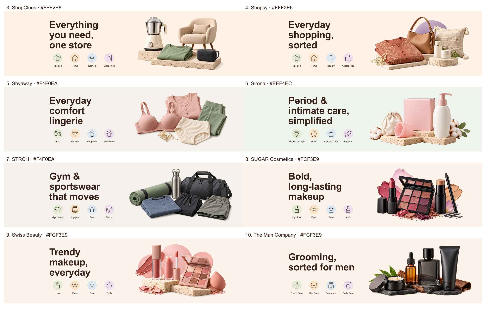
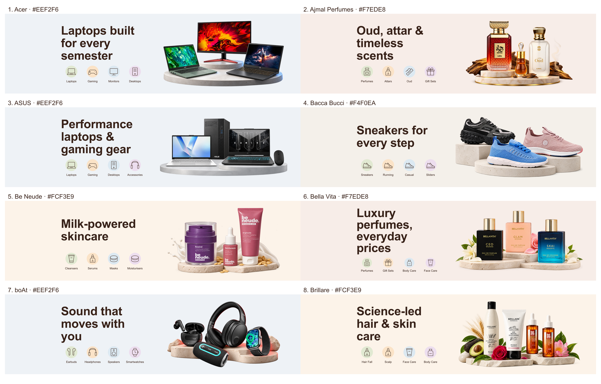
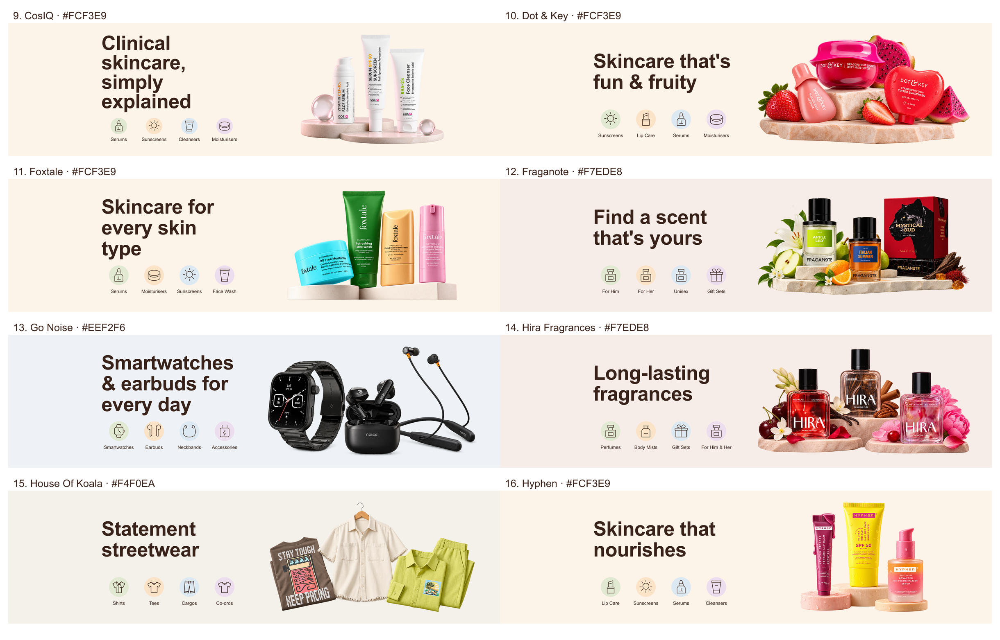
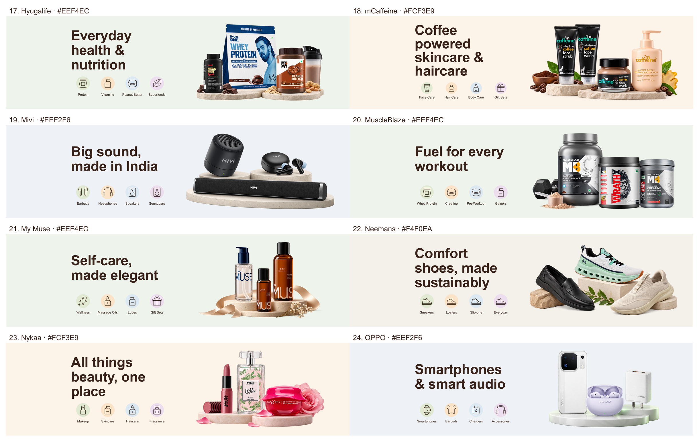

# Store Header Banners

34 store-header banner PNGs for a cashback storefront. Each production banner is 2400 × 650 pixels, opaque, with an embedded sRGB profile.

- The first 10 banners use generic unbranded products.
- The remaining 24 use real catalogue product references with visible branding where present.
- Left 18% is empty for website overlays. Product groups occupy the right side and remain complete in right-half crops.
- Background colours, headlines and four category labels follow the supplied briefs.

The branded scenes are AI-composed from catalogue photographs. They are not unaltered product photos; fine packaging text and some details may differ.

## Downloads and documentation

- [Download the 24 branded banners](unidays-remaining-24-branded-banners.zip)
- [Download banners 3–10 from the original batch](unidays-banners-3-10.zip)
- [Branded product sources, colours and checks](branded-banners-sources-and-checks.md)
- [Branded generation prompts](branded-banners-prompts.md)
- [Phitku and Rigo production notes](banner-production-notes.md)

## Original 10 banners

| Brand | PNG |
|---|---|
| Phitku | [phitku-banner.png](phitku-banner.png) |
| Rigo | [rigo-banner.png](rigo-banner.png) |
| ShopClues | [shopclues-banner.png](shopclues-banner.png) |
| Shopsy | [shopsy-banner.png](shopsy-banner.png) |
| Shyaway | [shyaway-banner.png](shyaway-banner.png) |
| Sirona | [sirona-banner.png](sirona-banner.png) |
| STRCH | [strch-banner.png](strch-banner.png) |
| SUGAR Cosmetics | [sugar-cosmetics-banner.png](sugar-cosmetics-banner.png) |
| Swiss Beauty | [swiss-beauty-banner.png](swiss-beauty-banner.png) |
| The Man Company | [the-man-company-banner.png](the-man-company-banner.png) |

## Branded banners

| Brand | PNG | Background |
|---|---|---|
| Acer | [acer-banner.png](acer-banner.png) | #EEF2F6 |
| Ajmal Perfumes | [ajmal-perfumes-banner.png](ajmal-perfumes-banner.png) | #F7EDE8 |
| ASUS | [asus-banner.png](asus-banner.png) | #EEF2F6 |
| Bacca Bucci | [bacca-bucci-banner.png](bacca-bucci-banner.png) | #F4F0EA |
| Be Neude | [be-neude-banner.png](be-neude-banner.png) | #FCF3E9 |
| Bella Vita | [bella-vita-banner.png](bella-vita-banner.png) | #F7EDE8 |
| boAt | [boat-banner.png](boat-banner.png) | #EEF2F6 |
| Brillare | [brillare-banner.png](brillare-banner.png) | #FCF3E9 |
| CosIQ | [cosiq-banner.png](cosiq-banner.png) | #FCF3E9 |
| Dot & Key | [dot-and-key-banner.png](dot-and-key-banner.png) | #FCF3E9 |
| Foxtale | [foxtale-banner.png](foxtale-banner.png) | #FCF3E9 |
| Fraganote | [fraganote-banner.png](fraganote-banner.png) | #F7EDE8 |
| Go Noise | [go-noise-banner.png](go-noise-banner.png) | #EEF2F6 |
| Hira Fragrances | [hira-fragrances-banner.png](hira-fragrances-banner.png) | #F7EDE8 |
| House Of Koala | [house-of-koala-banner.png](house-of-koala-banner.png) | #F4F0EA |
| Hyphen | [hyphen-banner.png](hyphen-banner.png) | #FCF3E9 |
| Hyugalife | [hyugalife-banner.png](hyugalife-banner.png) | #EEF4EC |
| mCaffeine | [mcaffeine-banner.png](mcaffeine-banner.png) | #FCF3E9 |
| Mivi | [mivi-banner.png](mivi-banner.png) | #EEF2F6 |
| MuscleBlaze | [muscleblaze-banner.png](muscleblaze-banner.png) | #EEF4EC |
| My Muse | [my-muse-banner.png](my-muse-banner.png) | #EEF4EC |
| Neemans | [neemans-banner.png](neemans-banner.png) | #F4F0EA |
| Nykaa | [nykaa-banner.png](nykaa-banner.png) | #FCF3E9 |
| OPPO | [oppo-banner.png](oppo-banner.png) | #EEF2F6 |

